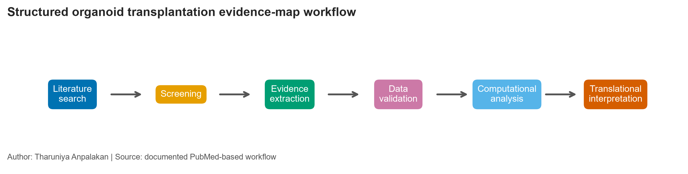
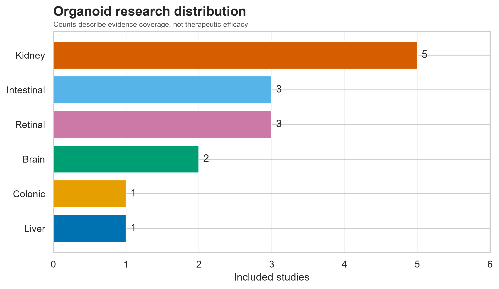
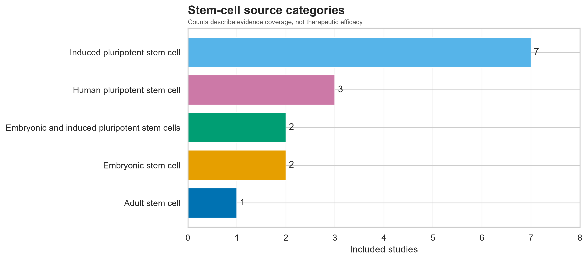
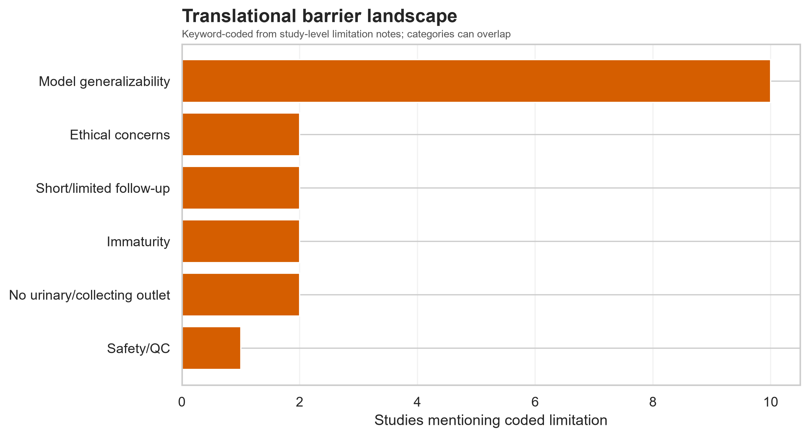
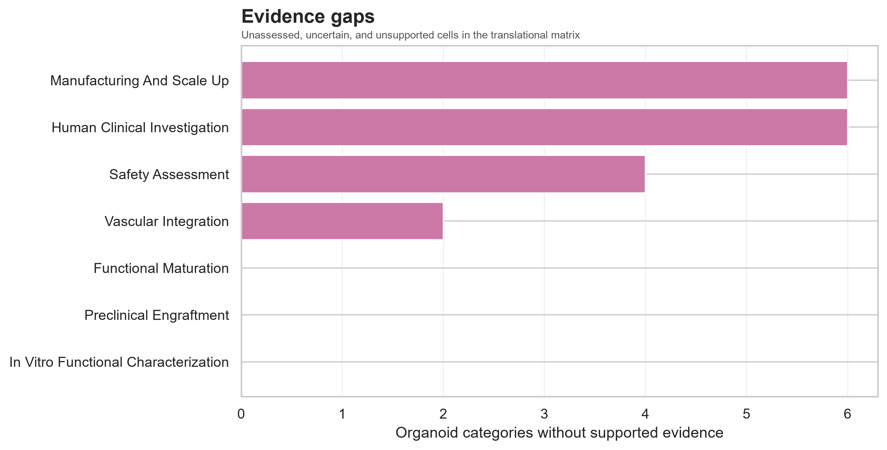

# Organoid Transplantation Research Landscape and Translational Applications

### A Reproducible Computational Evidence-Mapping Study

**Tharuniya Anpalakan**  
Department of Applied Sciences  
Northumbria University  
Newcastle upon Tyne, United Kingdom  
w25070895@northumbria.ac.lk

## Research overview

Organoid transplantation is an emerging branch of regenerative medicine in which self-organizing three-dimensional tissues are implanted to study maturation, repair, vascularization, and host integration. The literature spans distinct organoid types, cell sources, recipient species, graft sites, and outcome definitions, making simple claims of “success” misleading. This repository provides a transparent structured evidence map centred on a curated study database, an evidence-backed heterogeneous network, and a non-numeric translational matrix. It separates preclinical organoid grafts from conventional organ transplantation and from transplantation of isolated differentiated cells. Every study row links to a verified PubMed record, every network edge stores supporting study IDs, and missing or unassessed outcomes remain distinct from negative findings. The map is a bounded, reproducible seed corpus rather than an exhaustive systematic review.

## Research highlights

| Executed metric | Value |
|---|---:|
| Identifier-verified primary studies | **15** |
| Organoid categories | **6** |
| Stem-cell source categories | **5** |
| Experimental-model categories | **9** |
| Evidence-backed network relationships | **75** |
| Human organoid-graft outcome studies | **0** |

All included evidence is **preclinical in vivo**. Counts describe this curated corpus; they are not therapeutic success rates.

## Featured organoid research network


The heterogeneous NetworkX graph links organoid types to stem-cell sources, target tissues, experimental models, engraftment-reporting states, and study-coded translational barriers. Nodes encode category and label; edges encode relationship, supporting `study_ids`, and evidence count. The force-directed layout is descriptive: proximity or degree does not establish efficacy, causal importance, or clinical readiness. The complete machine-readable graph is available as [GraphML](results/organoid_research_network.graphml), with [network metrics](results/network_metrics.csv).

## Curated research dataset

| ID | Year | Organoid | Model | Engraftment | Key functional endpoint |
|---|---:|---|---|---|---|
| ORG001 | 2012 | Colonic | Mouse mucosal injury | Positive | Long-term self-renewing epithelium |
| ORG002 | 2013 | Liver | Immunodeficient mouse | Positive | Human protein production and drug metabolism |
| ORG008 | 2018 | Kidney | Immunodeficient mouse | Positive | Glomerular perfusion and tubular maturation |
| ORG012 | 2022 | Brain | Athymic neonatal rat | Positive | Sensory responses and circuit integration |
| ORG015 | 2023 | Retinal | Rat degeneration/tumorigenicity models | Positive | Photoreceptor maturation and light response |

The full [CSV dataset](data/processed/organoid_study_database.csv) retains DOI, PMID, graft site, evidence stage, safety, limitations, and direct provenance. See the [data dictionary](docs/data_dictionary.md), [coding guide](docs/evidence_coding_guide.md), and [provenance statement](docs/data_provenance.md).

## Research workflow



Queries, retrieval date, eligibility, deduplication logic, and scope limits are documented in the [search strategy](docs/search_strategy.md), [eligibility criteria](docs/eligibility_criteria.md), and [study selection](docs/study_selection.md).

## Key findings

- Kidney organoids are the most represented category (5/15), reflecting intensive work on vascularization, glomerular maturation, and tracer handling—not whole-kidney replacement.
- The corpus contains preclinical engraftment evidence for kidney, intestinal/colonic, retinal, liver, and brain/cortical constructs across mouse, rat, and chicken embryo systems.
- Host or chimeric vascular integration is documented in kidney, intestinal, liver, and brain graft settings; the biological origin and maturity of vessels vary.
- Functional endpoints are heterogeneous: epithelial repair, metabolic protein/drug handling, visual responses, glomerular sieving, and neural circuit activity cannot be combined into one efficacy statistic.
- Prospective safety, immune compatibility, standardized manufacture, organ-scale physiology, durable integration, and human outcome evidence remain sparse.


## Translational evidence map


`Supported` means at least one included report documents a category; `Unsupported` means an assessed negative result; `Uncertain` denotes incomplete or conflicting support; and `Unassessed` means the corpus does not evaluate it. This framework deliberately avoids a numerical clinical-readiness score. See [translational interpretation](docs/translational_readiness.md) and the [machine-readable matrix](results/translational_evidence_matrix.csv).

## Scientific background

Organoids differ from simple spheroids through organ-specific self-organization and from organ-on-chip systems through their biological rather than device identity. Adult stem cells, ESCs, iPSCs, and tissue progenitors create different opportunities and constraints. Transplantation can expose immature constructs to perfusion and physiological signals, but ectopic sites and xenogeneic hosts limit inference. The detailed [scientific background](docs/scientific_background.md) covers retinal, intestinal/colonic, kidney, liver, and brain applications and the distinction between animal engraftment, human feasibility, clinical trials, and approved therapy.

## Original research foundation

This computational project builds on earlier research materials, including the distinct coauthored review:

> Sandamini N, Jayaweera TC, Naseerdeen SA, Anpalakan T, Mohammed Safrin AA. *Future direction towards human in-vivo organoid transplantation*. BMS The Journal of Applied Learning. 2025;3(2):80–87. Online ISSN 2989-0705. [Official issue record](https://bms.ac.lk/Journal-of-Applied-Learning/volume-3-issue-2-july-2025/).

The earlier article’s historical authorship is preserved. Its local PDF and an unpublished course poster remain in an ignored private directory pending redistribution permission. The new code, dataset, figures, and computational report are authored by Tharuniya Anpalakan.

## Computational methods

The pipeline validates identifiers, duplicates, required fields, evidence stages, and controlled reporting categories. Pandas produces descriptive tables; NetworkX builds the provenance-bearing graph; and Matplotlib/Seaborn generate colourblind-accessible PNG/SVG figures. Study counts are never interpreted as clinical probability. Quality is reported by design-relevant domains rather than an arbitrary composite score.

```powershell
python -m venv .venv
.\.venv\Scripts\Activate.ps1
python -m pip install -r requirements.txt
python scripts/run_pipeline.py
python scripts/generate_notebooks.py
python scripts/execute_notebooks.py
python scripts/render_report.py
python -m pytest
```

Optional live metadata retrieval (network access required):

```powershell
python -c "from pathlib import Path; from src.literature_search import search_pubmed; search_pubmed('(organoid*[Title/Abstract]) AND (transplant*[Title/Abstract] OR engraft*[Title/Abstract])', Path('data/raw/pubmed_search.json'))"
```

Python **3.11 or newer** is supported. The completed audit run used Python 3.14.2 with package versions pinned in `requirements.txt`; figure layout uses random seed 42.

## Scientific figures

| Evidence coverage | Cell sources | Barriers | Gaps |
|---|---|---|---|
|  |  |  |  |

Captions and data-source notes are in [figure_captions.md](docs/figure_captions.md). No source photograph or copyrighted journal figure is republished.

## Limitations

This is a single-reviewer structured map, not an exhaustive systematic review. Selection bias, database coverage, abstract-level extraction, linked reports from related experimental programmes, biological heterogeneity, incomplete safety reporting, and unequal follow-up constrain inference. Animal models differ in species, immune status, graft site, and endpoint. `Not reported` and `Not assessed` do not mean failure. No mapped study establishes routine human organoid transplantation or an approved organoid therapy.

## Repository structure

```text
data/processed/   curated evidence database
data/metadata/    search and source-image inventories
docs/             methods, scientific context, provenance, audit
figures/          nine PNG/SVG figure pairs
notebooks/        six executable analysis narratives
references/       verified BibTeX records
reports/          editable report source and rendered PDF
results/          tables, GraphML network, evidence matrix
scripts/          end-to-end execution utilities
src/              validated analysis modules
tests/            synthetic software tests
```

## Research report

Read the standalone [computational research report](reports/organoid_transplantation_evidence_mapping.pdf) or edit its [source](reports/organoid_transplantation_evidence_mapping.qmd). This independent report is not a peer-reviewed publication.

## References and contact

The complete verified bibliography is in [bibliography.bib](references/bibliography.bib).

Material AI-assisted development is disclosed transparently: OpenAI Codex assisted repository construction, code generation, metadata checking, and drafting. The named author remains responsible for scientific interpretation, source verification, and any reuse or publication decision. This is a project disclosure, not an assignment declaration or a claim of AI authorship.

**Tharuniya Anpalakan**  
w25070895@northumbria.ac.lk

