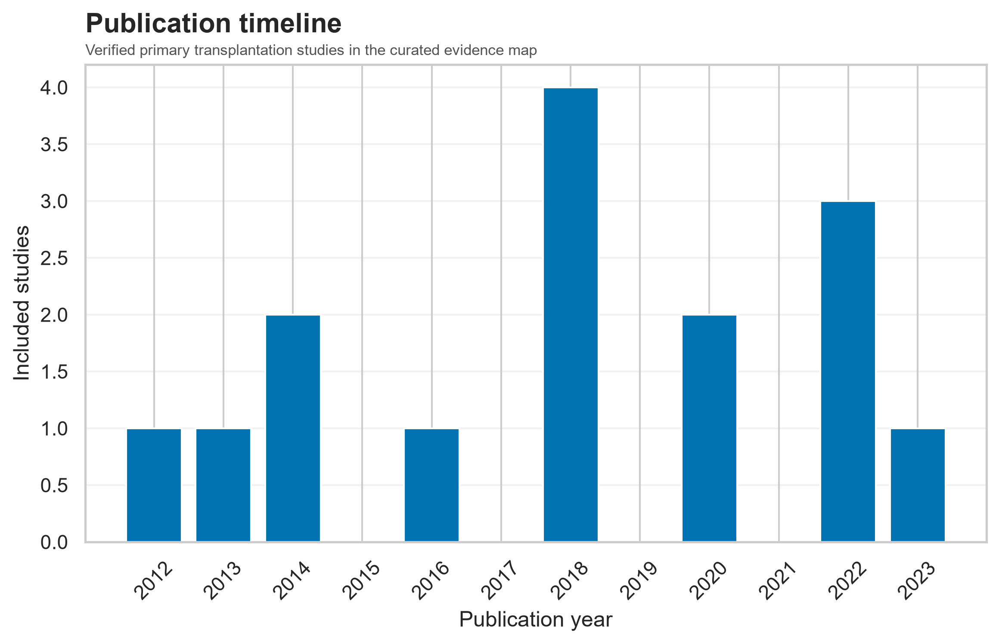
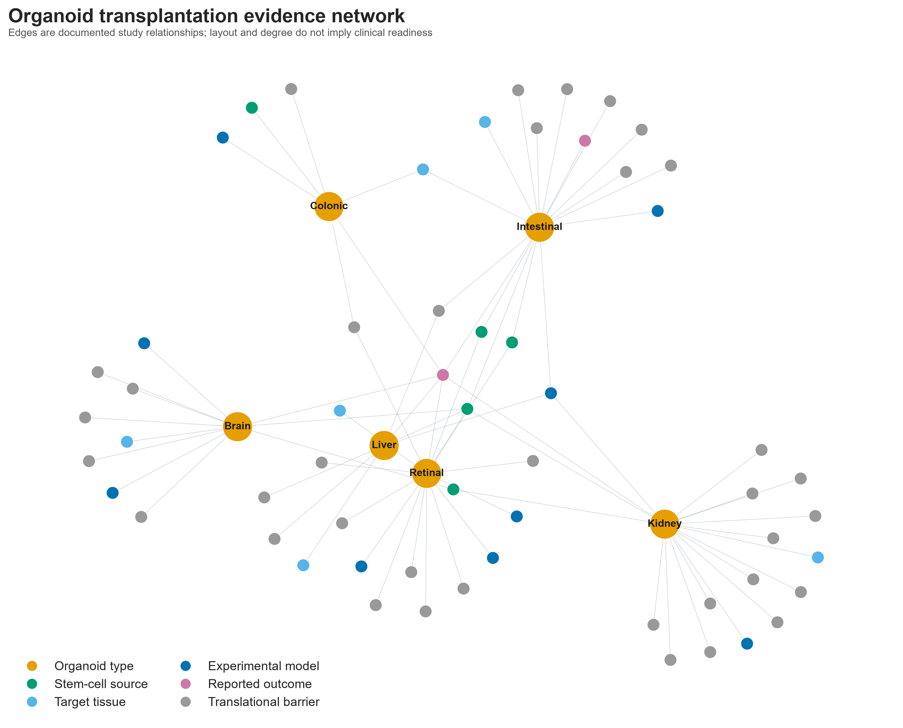
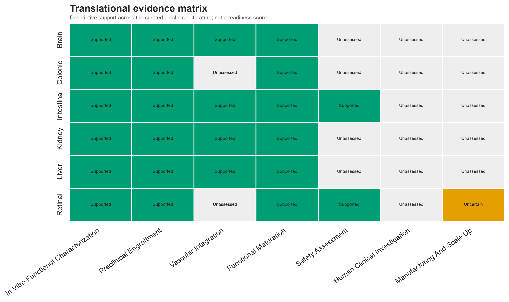

# Abstract

Organoid transplantation research spans heterogeneous tissues, cell sources, recipient models, graft sites, and endpoints. This structured evidence map curates 15 identifier-verified primary preclinical studies published from 2012–2023 and classifies organoid category, stem-cell origin, experimental model, engraftment, vascularization, functional outcomes, safety, and limitations. A reproducible Python workflow validates the dataset, exports descriptive summaries, constructs a study-provenanced heterogeneous network, and generates a non-numeric translational evidence matrix. The executed network contains 64 nodes and 75 evidence-backed relationships. Kidney studies are most frequent, but coverage is not interpreted as efficacy. Across tissue categories, graft survival, maturation, host vascularization, epithelial repair, glomerular sieving, visual response, metabolic function, and neural circuit interaction have been reported in animal models. Human organoid-graft outcome evidence is absent from the included corpus. Major gaps include standardized manufacture, physiological drainage, immune compatibility, prospective safety, durable organ-scale function, and human trials. The map is a bounded single-reviewer corpus rather than an exhaustive systematic review.

# Introduction

Organoids are self-organizing three-dimensional tissues derived from adult or pluripotent stem cells. Transplantation may provide vascular and physiological cues unavailable in vitro, making graft models useful for developmental biology, disease modelling, and regenerative-medicine research. However, the word “transplantation” is used for biologically different interventions, from isolated RPE cells to whole donor organs. This project restricts its analytic corpus to primary in vivo studies of organoids, organ buds, or organoid-derived three-dimensional tissue sheets.

# Scientific background

Organoids reproduce selected tissue features but lack the scale and complete system integration of an organ. Adult stem-cell cultures often preserve epithelial identity; ESCs and iPSCs support broader developmental differentiation but introduce line variation, genomic, ethical, and manufacturing considerations. Animal implantation can improve perfusion and maturation while creating xenogeneic or chimeric contexts. Retinal sheets, intestinal epithelium, kidney nephron structures, liver organ buds, and neural organoids therefore require distinct functional endpoints and cannot share one readiness score. Detailed tissue-specific context is provided in `docs/scientific_background.md`.

# Research objectives

The analysis identifies eligible studies, builds a traceable machine-readable database, compares organoid types and cell sources, maps recipient models and outcomes, distinguishes preclinical from clinical evidence, constructs a source-backed network, and describes translational gaps without treating study share as success probability.

# Literature acquisition strategy

PubMed searches on 18 October 2026 combined `organoid*` with `transplant*` or `engraft*`, supplemented by organ-specific terms and backward checking from supplied research materials. ClinicalTrials.gov was consulted for stage distinctions. Records were deduplicated by DOI, PMID, and normalized title. Complete queries and limits appear in `docs/search_strategy.md`.

# Eligibility criteria

Primary research was eligible when a self-organizing 3D organoid, organ bud, or organoid-derived tissue sheet was transplanted into a living recipient and evaluated in vivo. Reviews, conventional organ transplants, isolated-cell therapies, in vitro-only studies, non-organoid fetal tissue, and announcements without peer-reviewed outcome data were excluded.

# Evidence extraction methodology

The schema stores bibliographic identifiers, organoid and cell-source categories, target and disease context, recipient model, graft site, approach, evidence stage, engraftment, vascularization, function, safety, limitations, design, and a direct PubMed link. Reporting uses five states: not reported, not assessed, reported negative, reported positive, and unclear.

# Dataset validation

Automated validation checks required columns and values, unique study IDs, DOI and PMID syntax, duplicate identifiers, evidence-stage vocabulary, organoid categories, and reporting states. Fifteen records passed the executed validation run.

# Computational analysis methods

Pandas produces category distributions. NetworkX builds an undirected heterogeneous graph in which edges link organoid types to sources, tissues, models, engraftment states, and barriers. Each edge carries supporting study IDs and an evidence count. The translational matrix aggregates descriptive support without creating a clinical-readiness score. Matplotlib and Seaborn generate reproducible colourblind-accessible figures; the force layout uses seed 42.

# Research landscape results

The 15 verified studies cover six organoid categories and five recorded cell-source categories. Five kidney studies make kidney the largest group. Publication dates span 2012–2023. Every included report is preclinical in vivo; no human organoid-graft outcome report met the eligibility criteria.

Functional endpoints are diverse. Colonic organoids formed durable epithelium in mouse injury models; PSC-derived intestinal organoids matured ectopically; liver buds showed metabolic activity and rescued a mouse failure model; kidney grafts developed perfusion and selected filtration features; retinal sheets produced electrophysiological or behavioural visual responses; and neural organoids matured and interacted with rodent circuits. These results cannot be pooled into a common efficacy estimate.

# Network analysis

The executed graph contains 64 nodes and 75 unique evidence-backed relationships. Its connected structure reflects shared cell sources, outcome states, model labels, and limitations. Centrality is not interpreted as therapeutic effectiveness.

# Translational evidence mapping

The matrix describes whether each category is supported, unsupported, uncertain, or unassessed within this corpus. Preclinical engraftment is broadly supported, while safety assessment is limited and human clinical investigation is unassessed for every organoid category.

# Discussion

Transplantation frequently improves organoid maturation because grafts encounter host vasculature, extracellular matrix, and systemic signals. Yet this benefit complicates interpretation: a perfused ectopic xenograft is neither a self-contained organ nor necessarily transferable to an immunocompetent human site. Kidney evidence illustrates this distinction most clearly. Glomerular microstructures can show size-selective tracer movement, but missing urinary outflow, limited scale, immaturity, and host-derived vessels preclude claims of kidney replacement.

Retinal sheet and neural graft studies show tissue-specific integration and functional signals, but long-term safety, product identity, circuit consequences, and surgical translation remain unresolved. Intestinal epithelial repair is promising in animal injury models, though target-site engraftment is not guaranteed. Liver organ-bud evidence demonstrates powerful proof of concept at small scale while leaving biliary, vascular, metabolic, and manufacturing challenges.

# Research limitations

The corpus is a verified seed map produced by one reviewer, not an exhaustive systematic review. It is subject to selection and publication bias, abstract-level extraction limits, incomplete safety reporting, and possible dependence among follow-up studies. Species, immune status, graft site, sample size, outcome definitions, and follow-up differ substantially. Absence of a report is not a negative finding. Quality domains indicate reporting, not low risk of bias.

# Conclusions

Organoid transplantation has generated credible preclinical evidence of engraftment and tissue-specific maturation across several biological systems. The field has not yet demonstrated routine human organoid-graft therapy. Translation depends on controlled manufacture, safety, immune and vascular integration, physiological connection to host systems, and rigorous human investigation. This repository makes the current bounded evidence traceable and computationally reproducible while preserving those uncertainties.

# References

1. Yui S, Nakamura T, Sato T, et al. Functional engraftment of colon epithelium expanded in vitro from a single adult Lgr5-positive stem cell. *Nature Medicine*. 2012;18:618–623. doi:10.1038/nm.2695.

2. Takebe T, Sekine K, Enomura M, et al. Vascularized and functional human liver from an iPSC-derived organ bud transplant. *Nature*. 2013;499:481–484. doi:10.1038/nature12271.

3. Assawachananont J, Mandai M, Okamoto S, et al. Transplantation of embryonic and induced pluripotent stem cell-derived 3D retinal sheets into retinal degenerative mice. *Stem Cell Reports*. 2014;2:662–674. doi:10.1016/j.stemcr.2014.03.011.

4. Watson CL, Mahe MM, Munera J, et al. An in vivo model of human small intestine using pluripotent stem cells. *Nature Medicine*. 2014;20:1310–1314. doi:10.1038/nm.3737.

5. Sharmin S, Taguchi A, Kaku Y, et al. Human induced pluripotent stem cell-derived podocytes mature into vascularized glomeruli upon experimental transplantation. *J Am Soc Nephrol*. 2016;27:1778–1791. doi:10.1681/ASN.2015010096.

6. Mansour AAF, Gonçalves JT, Bloyd CW, et al. An in vivo model of functional and vascularized human brain organoids. *Nature Biotechnology*. 2018;36:432–441. doi:10.1038/nbt.4127.

7. Bantounas I, Ranjzad P, Tengku F, et al. Generation of functioning nephrons by implanting human pluripotent stem cell-derived kidney progenitors. *Stem Cell Reports*. 2018;10:766–779. doi:10.1016/j.stemcr.2018.01.008.

8. van den Berg CW, Ritsma L, Avramut MC, et al. Renal subcapsular transplantation of PSC-derived kidney organoids induces neo-vasculogenesis and significant glomerular and tubular maturation in vivo. *Stem Cell Reports*. 2018;10:751–765. doi:10.1016/j.stemcr.2018.01.041.

9. McLelland BT, Lin B, Mathur A, et al. Transplanted hESC-derived retina organoid sheets differentiate, integrate, and improve visual function in retinal degenerate rats. *Investigative Ophthalmology & Visual Science*. 2018;59:2586–2603. doi:10.1167/iovs.17-23646.

10. Singh A, Poling HM, Sundaram N, et al. Evaluation of transplantation sites for human intestinal organoids. *PLOS ONE*. 2020;15:e0237885. doi:10.1371/journal.pone.0237885.

11. van den Berg CW, et al. In vivo assessment of size-selective glomerular sieving in transplanted human induced pluripotent stem cell-derived kidney organoids. *J Am Soc Nephrol*. 2020;31:921–929. doi:10.1681/ASN.2019060573.

12. Revah O, Gore F, Kelley KW, et al. Maturation and circuit integration of transplanted human cortical organoids. *Nature*. 2022;610:319–326. doi:10.1038/s41586-022-05277-w.

13. Koning M, Dumas SJ, Avramut MC, et al. Vasculogenesis in kidney organoids upon transplantation. *npj Regenerative Medicine*. 2022;7:40. doi:10.1038/s41536-022-00237-4.

14. Nakanishi A, Toyama S, Onozato D, et al. Effects of human induced pluripotent stem cell-derived intestinal organoids on colitis-model mice. *Regenerative Therapy*. 2022;21:351–361. doi:10.1016/j.reth.2022.08.004.

15. Watari K, Yamasaki S, Tu H-Y, et al. Self-organization, quality control, and preclinical studies of human iPSC-derived retinal sheets for tissue-transplantation therapy. *Communications Biology*. 2023;6:164. doi:10.1038/s42003-023-04543-5.

16. Sandamini N, Jayaweera TC, Naseerdeen SA, Anpalakan T, Mohammed Safrin AA. Future direction towards human in-vivo organoid transplantation. *BMS The Journal of Applied Learning*. 2025;3(2):80–87. Online ISSN 2989-0705.

The same verified records are available in `references/bibliography.bib`. The prior review’s full historical authorship is preserved.

# Reproducibility statement

The repository includes pinned dependencies, source code, six notebooks, tests, CSV outputs, GraphML, figure sources, and execution commands. The original PDFs are not required and remain privately ignored. The completed audit used Python 3.14.2; all six notebooks executed with no cell errors, and 11 software tests passed. The report is independent computational work authored by Tharuniya Anpalakan and is not a peer-reviewed journal publication.

OpenAI Codex materially assisted repository construction, code generation, metadata checking, and drafting. The named author remains responsible for scientific interpretation, verification, and any publication or reuse decision. The system is not listed as a scientific author.

